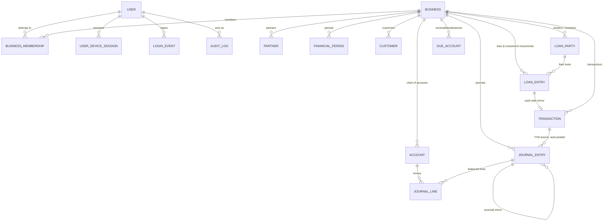
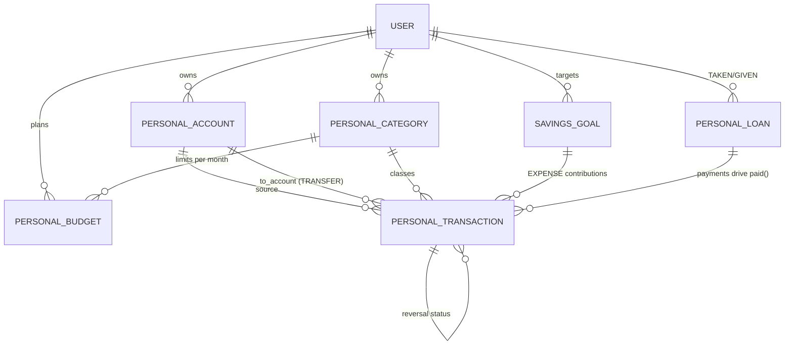
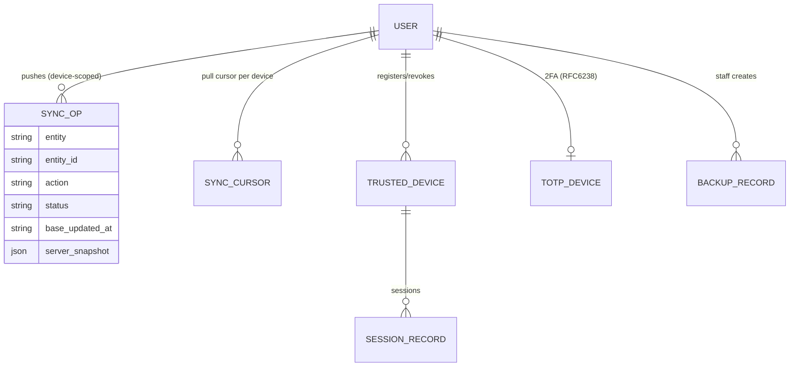

# Database ERD (Mermaid)

Phase 1 entities are implemented; the remaining entities listed here are the
planned schema the engine grows into phase by phase.



> **Supply chain removed.** The sales / purchase / inventory / supplier
> modules were deleted; purchases are now a single small খরচ (EXPENSE) book in
> the web UI. See `PROJECT_CHECKLIST.md` → Phase 4.

## Personal finance (Phase 6) — separate environment



## Offline sync & ops (Phase 8)



**Sync rule:** server is authoritative; client UUIDs + `client_reference`
make pushes idempotent; stale `base_updated_at` → `conflict` (server snapshot
returned, no auto-merge of money). Money rows immutable over sync — post a
reversal, never update/delete. Health probes: `/health/`, `/api/health/`.

**Isolation rule:** no personal model carries a `business` FK — user-owned
only, enforced by schema and asserted in tests; business ledgers and
personal ledgers never join each other.

    SUPPLIER ||--o{ PURCHASE_INVOICE : "received"
    SUPPLIER ||--o{ SUPPLIER_LEDGER_ENTRY : "payable lines"
    WAREHOUSE ||--o{ STOCK_MOVEMENT : "holds"
    PRODUCT ||--o{ STOCK_MOVEMENT : "stock in/out"
    SALES_INVOICE ||--o{ SALES_INVOICE_ITEM : "lines"
    SALES_INVOICE ||--o{ SALE_RETURN : "returns"
    PURCHASE_INVOICE ||--o{ PURCHASE_INVOICE_ITEM : "lines"
    PURCHASE_INVOICE ||--o{ PURCHASE_RETURN : "returns"

    USER {
        uuid id PK
        string username
        string email
        string pin_hash "app PIN lock"
        bool two_factor_enabled
        uuid active_business_id
    }
    BUSINESS {
        uuid id PK
        string name
        string slug
        string currency "BDT"
        string timezone "Asia/Dhaka"
    }
    BUSINESS_MEMBERSHIP {
        uuid id PK
        string role "ADMIN|PARTNER"
        json partner_permissions
        bool is_active
    }
    PARTNER {
        uuid id PK
        string name
        string status
        decimal initial_capital "numeric(18,2)"
        date joining_date
        uuid linked_user FK "platform account"
        uuid created_by FK
    }
    PARTNER_CAPITAL_EVENT {
        uuid id PK
        string kind "contribution|withdrawal|profit_share"
        decimal amount
    }
    CUSTOMER {
        uuid id PK
        string name
        string category
        decimal opening_balance
        uuid assigned_partner FK
    }
    CUSTOMER_ASSIGNMENT {
        uuid id PK
        uuid customer FK
        uuid partner FK
        decimal opening_due "partner-wise due, never merged"
    }
    TRANSACTION {
        uuid id PK
        string type "credit|payment|income|expense|advance|refund|adjustment|transfer"
        decimal amount "numeric(18,2)"
        date transaction_date "business date"
        datetime created_at "record timestamp"
        string payment_method "cash|bank|bkash|nagad|rocket|card|other"
        uuid partner FK "attribution"
        uuid customer FK nullable
    }
    DUE_ACCOUNT {
        uuid id PK
        uuid customer FK
        uuid partner FK "per-partner book"
        decimal balance
    }
    DUE_ENTRY {
        uuid id PK
        uuid due_account FK
        string kind "credit|collection|advance|adjustment|refund|return"
        decimal amount
        decimal remaining "uncollected part, oldest-first allocation"
    }
    PRODUCT {
        uuid id PK
        string name
        string sku "unique per business (when set)"
        string unit "PCS|KG|LTR|BOX..."
        decimal purchase_price
        decimal sale_price
        decimal tax_rate "percent"
        decimal low_stock_threshold
        string status
    }
    WAREHOUSE {
        uuid id PK
        string name "unique per business"
        bool is_default "exactly one per business"
        bool is_active
    }
    STOCK_MOVEMENT {
        uuid id PK
        uuid product FK
        uuid warehouse FK
        string movement_type "PURCHASE_IN|SALE_OUT|SALE_RETURN_IN|PURCHASE_RETURN_OUT|MANUAL_ADJUST"
        decimal quantity "SIGNED; stock = Σ movements, no mutable counter"
        decimal unit_cost nullable
        date movement_date
        string source_kind
        uuid source_id "invoice/return id"
    }
    SUPPLIER {
        uuid id PK
        string name
        decimal opening_balance "we-owe at creation"
        string status
    }
    SUPPLIER_LEDGER_ENTRY {
        uuid id PK
        string kind "purchase|payment|return|adjustment|reversal"
        string direction "up|down"
        decimal amount
        decimal remaining "unpaid part of purchase lines"
        uuid transaction FK nullable
        date entry_date
    }
    SALES_INVOICE {
        uuid id PK
        string invoice_no "SAP-YYYYMMDD-####"
        date invoice_date
        uuid customer FK
        uuid partner FK "whose due book this sale posts to"
        uuid warehouse FK
        decimal subtotal
        decimal discount_total
        decimal tax_total
        decimal grand_total
        decimal paid_amount "paid at sale time"
        uuid credit_transaction FK
        uuid paid_transaction FK nullable
        string status "COMPLETED|REVERSED"
        string client_reference "idempotency"
    }
    SALES_INVOICE_ITEM {
        uuid id PK
        uuid invoice FK
        uuid product FK
        decimal quantity "numeric(18,3)"
        decimal unit_price
        decimal discount
        decimal tax_rate
        decimal tax_amount
        decimal line_total
    }
    SALE_RETURN {
        uuid id PK
        uuid invoice FK
        string return_no "SRTN-..."
        date return_date
        decimal total_amount
        bool due_reduced
    }
    PURCHASE_INVOICE {
        uuid id PK
        string purchase_no "PRCH-YYYYMMDD-####"
        date purchase_date
        uuid warehouse FK
        uuid partner FK nullable "attribution"
        decimal subtotal
        decimal discount_total
        decimal tax_total
        decimal grand_total
        decimal paid_amount
        string status
        string client_reference
    }
    PURCHASE_INVOICE_ITEM {
        uuid id PK
        uuid invoice FK
        uuid product FK
        decimal quantity
        decimal unit_cost
        decimal line_total
    }
    PURCHASE_RETURN {
        uuid id PK
        uuid invoice FK
        string return_no "PRTN-..."
        date return_date
        decimal total_amount
    }
    JOURNAL_ENTRY {
        uuid id PK
        date transaction_date
        bool posted
        uuid reversal_of FK "reversals, no silent deletes"
    }
    JOURNAL_LINE {
        uuid id PK
        uuid journal_entry FK
        uuid account FK
        decimal debit
        decimal credit "debit==credit enforced in code + report"
    }
    ACCOUNT {
        uuid id PK
        string code "chart of accounts"
        string type "ASSET|LIABILITY|INCOME|EXPENSE|EQUITY"
        uuid parent FK
    }
    FINANCIAL_PERIOD {
        int id PK
        string name "e.g. 2026-09"
        date start_date
        date end_date
        bool is_locked
        uuid locked_by FK
    }
    AUDIT_LOG {
        uuid id PK
        string action
        string resource_type
        string resource_id
        json previous
        json changes
        string reason
    }
```

## Key integrity rules

- `CustomerAssignment` keeps **partner-wise** dues separate; collections
  allocate against one assignment only — cross-partner reduction impossible.
- `Transaction.created_at` never drives reports; `transaction_date` does.
- Locked `FINANCIAL_PERIOD`: transactions inside need ADMIN approval and log
  `AuditLog.action IN (update, reversal)` with a reason.
- Product stock is always `Σ StockMovement.quantity` (signed) — purchases
  add, sales subtract, returns/adjustments restore; no mutable counter can
  drift from history.
- Supplier payable is always `opening_balance + Σ SupplierLedgerEntry`
  signed effects, mirroring the due-book discipline.
- Every posted `JOURNAL_ENTRY` must have Σdebit = Σcredit (checked at post
  time and revisited by the trial-balance report).
